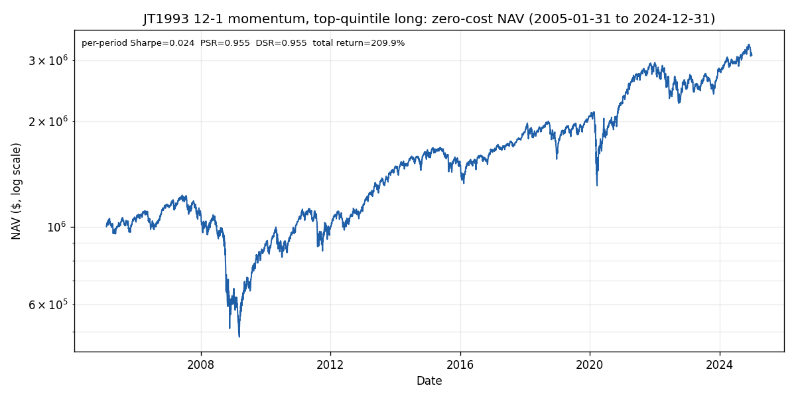
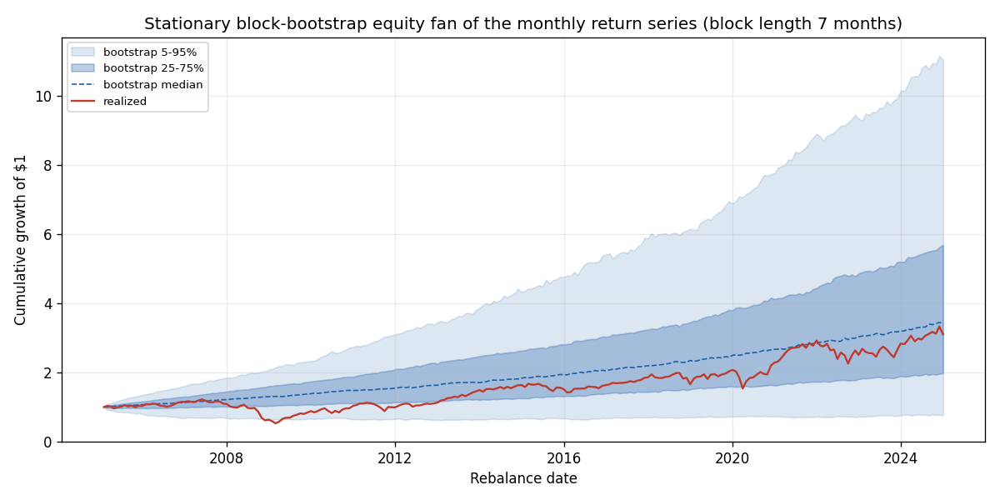
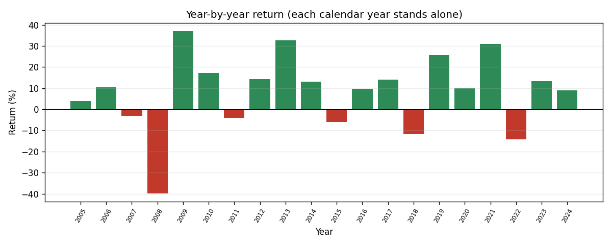
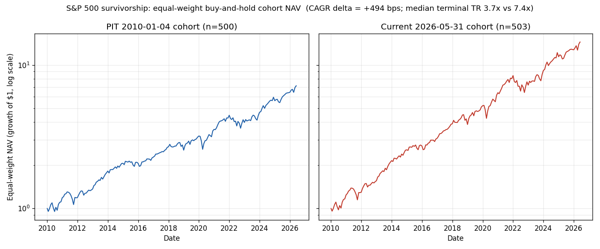

# pit-backtest

[](https://github.com/sjdoane/pit-backtest/actions/workflows/ci.yml)
[](https://github.com/sjdoane/pit-backtest/actions/workflows/perf-budget.yml)
[](LICENSE)

A U.S. equity daily-bar backtester built as a teaching artifact for systematic-trading research. It demonstrates four properties working together: structurally enforced point-in-time discipline, a CPCV-first validation API, Almgren-calibrated cost realism with honest uncertainty bounds, and engine self-validation against SSGA's published SPY total return plus a hand-computable benchmark.

It is not a production trading system. The audience is a reviewer or recruiter who wants to see the design judgment behind those four properties. v1 (milestones M1 through M5) is shipped; v1.1 is in progress. The blow-by-blow history lives in [`CHANGELOG.md`](CHANGELOG.md) and [`docs/ROADMAP.md`](docs/ROADMAP.md).

## Results at a glance

The capstone worked study: JT1993 12-1 top-quintile-long momentum on the survivorship-bias-free point-in-time S&P 500, 2005 to 2024.

| Metric | Value |
|---|---|
| Deflated Sharpe (zero-cost, full window) | **0.955** (one pre-specified strategy, so the DSR is the honest PSR-against-zero) |
| Annualized return / total return | 5.85% / 2.10x |
| Survivorship CAGR delta (PIT-2010 vs current cohort) | +494 bps (reframed as inclusion-bias-dominated, not oversold) |
| Engine self-validation | buy-and-hold SPY reconciles to SSGA's published NAV total return within 5 bps annualized on every trailing window |
| Code gates | `mypy --strict` clean (66 modules); ~790-test suite, green in CI |

The honesty is the point: the Deflated Sharpe DROPPED from a contaminated 0.971 to 0.955 when a dividend-basis bug was fixed ([ADR 0018](docs/decisions/0018-as-traded-dividend-basis.md)), and the repo reports the lower, honest number. The milestone passes whether or not the strategy clears a Deflated Sharpe of 0.95.

## What makes this different

Most open-source backtesters claim "event-driven" and "no lookahead." The differentiator here is that every inconvenient result is reported plainly rather than buried:

- **The deflated Sharpe is reported whether or not it clears the bar** (it is 0.955; a bug fix lowered it from 0.971 and the honest number stayed).
- **CPCV is reported as degenerate for a deterministic factor** ([ADR 0016](docs/decisions/0016-cpcv-deterministic-factor-and-block-bootstrap-uncertainty.md)), not dressed up as a distribution; a stationary block bootstrap is the honest path-uncertainty surface, with its block length set by the Politis-White selector (which judges the series near-iid).
- **The cost band is labelled a uniform-liquidity sensitivity surface, NOT a realized cost.**
- **The survivorship delta is reframed as inclusion-bias-dominated**, and even the spin-off bias the v1 studies do NOT correct is quantified honestly (per-name material, aggregate small): [`docs/research/0003-spinoff-bias.md`](docs/research/0003-spinoff-bias.md).

## Quickstart: reproduce the figures (no data needed)

The worked-study figures regenerate from a committed JSON artifact in seconds, with no vendor data bundle:

```
pip install -e ".[figures]"
python scripts/figures/regenerate.py     # or: make figures
```

Running the full study or the SPY reconciliation on real data needs a Sharadar subscription; see [Running on real data](#running-on-real-data).

## Worked study figures



Zero-cost NAV (log scale), annotated with the realized per-period Sharpe, PSR, and Deflated Sharpe. One pre-specified strategy, so the DSR has no multiple-testing family to deflate against and equals the PSR-against-zero (the corrected full-window value is 0.955).



The genuine path-uncertainty surface: the realized path (red) inside the stationary block-bootstrap percentile envelope. CPCV is reported as degenerate for a deterministic factor ([ADR 0016](docs/decisions/0016-cpcv-deterministic-factor-and-block-bootstrap-uncertainty.md)), so this bootstrap is the honest replacement for a CPCV fan.





The PIT-2010 S&P 500 cohort versus today's roster priced back to 2010, equal-weight buy-and-hold, with the CAGR delta in the caption. The delta is dominated by current-cohort inclusion bias (today's members were selected for growing into the index), so a median terminal total return is reported alongside the outlier-sensitive mean.

The full Markdown report (PSR/DSR, the cost-sensitivity band, the CPCV degeneracy, the commission seam decomposition, and the honest conclusion) is produced by `examples/sp500_momentum_study.py`; [`docs/METHODOLOGY.md`](docs/METHODOLOGY.md) maps each pillar to its research note, ADR, module, and figure, and the figure provenance (bundle, git SHA, content hash) is stamped in [`docs/figures/PROVENANCE.md`](docs/figures/PROVENANCE.md).

## Why this exists

Most open-source Python backtesters fall into one of two failure modes:

1. They allow lookahead bias by convention rather than by structure. A diligent user avoids it; an inattentive user produces spurious results.
2. They silently distort returns by under-modeling execution and data: zero slippage, no partial fills, no borrow, no point-in-time index membership, no corporate-action correctness.

This repo is an opinionated response to those failure modes within a deliberately narrow scope. The phase 1 survey at [`docs/research/0001-existing-backtesters.md`](docs/research/0001-existing-backtesters.md) and the phase 2 methodology synthesis at [`docs/research/0002-methodology.md`](docs/research/0002-methodology.md) explain what the existing landscape gets wrong and what the canonical literature says is right.

## Design pillars

- **Event-driven core with kernel sharing**. Every signal, order, and fill is an explicit timestamped event. The same kernel runs validation backtests and any future live execution; only the clock implementation differs. The pattern is taken from `nautilus_trader` and is documented in [`docs/research/0001-existing-backtesters.md`](docs/research/0001-existing-backtesters.md).
- **Structural lookahead protection at the API boundary, with documented trust boundaries**. The data layer's return types and the event-loop ordering prevent the common patterns. The remaining trust boundaries (arbitrary Python in callbacks, alternative-data joins computed outside the engine, feature-store wrappers) are enumerated explicitly in [`docs/decisions/0003-architecture.md`](docs/decisions/0003-architecture.md). This is the honest version of the "structurally impossible" claim.
- **CPCV-first validation**. Combinatorial Purged Cross-Validation is the primary validation surface. Walk-forward is exposed as a CPCV configuration with one path. Backtest results are distributions across paths; any single-Sharpe API on a CPCV result is a correctness bug.
- **The LdP chapter 14 scorecard**. PSR, DSR, MinTRL, HHI, drawdown stats, per-year decomposition are the default analytics. Raw Sharpe shown alone is a configuration error.
- **Cost realism with honest uncertainty bounds**. Default cost model is SquareRootImpact with Almgren 2005 calibration (eta=0.142, beta=0.6, gamma=0.314), labeled as a 1998-2000 calibration. Sensitivity bands at eta in [0.05, 0.30] are required in every backtest report. A `--impact-model=bouchaud` flag substitutes beta=0.5. At M2 the cost-tolerance enforcement contract is scaffolded but dormant by design (see [ADR 0011](docs/decisions/0011-tolerance-contract-dormancy-at-m2.md)).
- **Point-in-time data with persistent identifiers**. Dual-timestamp model (`period_end_dt`, `available_dt`) on every record. Typed `Universe` API with `is_member(asset_id, date)`. Persistent asset identifiers via Sharadar TICKERS.
- **Engine self-validation**. M1 reconciles buy-and-hold SPY against SSGA's published SPY NAV TR for the trailing 1Y / 3Y / 5Y / 10Y / SI periods (anchored on SSGA's as-of date) within 5 bps annualized per period; a deterministic hand-computable strategy is verified to exact match. Differential testing against `zipline-reloaded` was scoped out of M5 to v1.1 (ADR 0002).

## Explicit non-goals

- Not intraday or LOB-level market microstructure.
- Not options or other derivatives.
- Not multi-asset macro portfolios; equity only at v1.
- Not live trading. The kernel-sharing pattern is included for design discipline, not because live execution is in scope.
- Not crypto-specific market structure.
- Not a substitute for `vectorbtpro` for parameter-sweep research, `zipline-reloaded` for established factor work, or `nautilus_trader` for production-grade execution. This is a focused teaching artifact, not a feature-superset of any of them.

## Stack

- Python 3.11+
- `uv` for environment and dependency management
- Polars end-to-end (with `.to_pandas()` available on every public results object for users who prefer Pandas)
- NumPy for the inner kernel hot paths
- Pydantic for typed data models
- pytest with high coverage on the engine core
- mypy strict mode (gated in CI)
- Runs on Linux and WSL2; developed on Windows

## Performance budget

A 20-year backtest on 500 U.S. equity names completes in under 60 seconds on a laptop. The budget is tracked in CI via [`.github/workflows/perf-budget.yml`](.github/workflows/perf-budget.yml) using the `bench/spy_20y.py` synthetic harness (real Sharadar data is unavailable in CI per `dataset_versioning.md`). Per [ADR 0012](docs/decisions/0012-perf-budget-ci-phase-0-noise-floor.md) the workflow gates on a regression beyond `max(20%, 3 * sigma)` against an empirical noise floor (7-run median = 43.0 ms, CoV = 0.52%, on `ubuntu24-20260525.161.1`). The synthetic harness is a SPY-only single-ticker probe sized for per-bar dispatch overhead, so the gate is a smoke test for catastrophic regressions, not a fine-grained scaling check. Per ADR 0001 decision 18 the workflow is Linux-only; cross-platform reproducibility is disavowed.

## V1 data inventory

- [Sharadar SF1 ARQ](https://data.nasdaq.com/databases/SF1): point-in-time U.S. fundamentals (as-reported quarterly).
- [Sharadar SEP](https://data.nasdaq.com/databases/SEP): point-in-time prices and delistings with cash proceeds.
- [Sharadar TICKERS](https://data.nasdaq.com/databases/SF1): identifier history.

Documented gaps for v1: borrow rates (no v1 source; short tests are flagged as estimates), PIT S&P 500 reconstitution at effective-date resolution (the Sharadar quarterly membership snapshots are the v1 source; effective-date reconciliation is v1.1, per ADR 0017), full corporate-actions feed (rights offerings, special distributions, and spin-offs-as-share-distributions are out of v1 scope; the spin-off treatment bias is quantified in [`docs/research/0003-spinoff-bias.md`](docs/research/0003-spinoff-bias.md)).

## Repo layout

```
docs/
  ROADMAP.md            phased milestones
  METHODOLOGY.md        research pillar -> ADR -> module -> figure index
  TESTING.md            validation strategy, known-answer tests
  methodology/          per-topic implementation contracts
  research/             topical research syntheses (+ sources/)
  decisions/            numbered ADRs
  figures/              committed README figures + PROVENANCE.md
src/pit_backtest/       engine source (M1-M5 shipped)
tests/                  pytest suite (unit / integration / lint / bench)
scripts/
  figures/              reproducible figure generators (committed artifact)
  analysis/             reproducible one-off real-data analyses (bundle-gated)
data/snapshots/         vendor snapshots (gitignored; manifest.toml committed)
.github/workflows/      ci.yml (mypy + pytest) and perf-budget.yml
pyproject.toml
CHANGELOG.md
LICENSE
```

## Running on real data

The figure quickstart above needs no data. Running the worked study, the survivorship study, or the SPY reconciliation on real data requires a Sharadar subscription and a local snapshot under `data/snapshots/`.

```
uv sync --extra dev --extra dataops
# set the Nasdaq Data Link API key (never paste secrets in chat):
#   export NASDAQ_DATA_LINK_API_KEY=<your_key>   (legacy SHARADAR_API_KEY also accepted)
uv run python scripts/pull_m1_data.py --end-date 2026-04-30
uv run python -m examples.spy_buy_and_hold --compare-to-ssga      # exits 0 PASS / 1 FAIL / 2 NEEDS_DATA
uv run python -m examples.sp500_momentum_study                    # the capstone study (~11-15 min)
```

See [`docs/vendor/nasdaq-data-link-pull.md`](docs/vendor/nasdaq-data-link-pull.md) for the full pull procedure (including the SSGA XLSX downloads) and the test suite invocation.

<details>
<summary>Windows / OneDrive venv setup (the development machine)</summary>

On Windows, point `uv` at a venv outside OneDrive and force copy-mode linking (the default hardlink mode fails on OneDrive reparse points, and a venv created inside a OneDrive-synced tree accumulates corruption from interrupted installs). Set both at User scope:

```
[Environment]::SetEnvironmentVariable("UV_PROJECT_ENVIRONMENT", "C:\Users\<you>\.venvs\pit-backtest", "User")
[Environment]::SetEnvironmentVariable("UV_LINK_MODE", "copy", "User")
[Environment]::SetEnvironmentVariable("NASDAQ_DATA_LINK_API_KEY", "<your_key>", "User")
```

Open a new shell so the variables load. Verify with `uv pip show pandas`: the `Location` must be the `.venvs\pit-backtest` path, not an in-tree `.venv`. The Makefile targets are Unix-only; on Windows invoke the underlying `python scripts/...` commands directly (each `make` target documents its raw command).

</details>

## Reading order for a reviewer

- **Start here**: [`docs/METHODOLOGY.md`](docs/METHODOLOGY.md). It maps each research pillar to its governing ADR, the module that implements it, and the figure that illustrates it, so it is the fastest path from "what the literature says" to "what the code does."
- **Then the worked study**: [`examples/sp500_momentum_study.py`](examples/sp500_momentum_study.py) and its figures above, the artifact that exercises every pillar.
- **Deep dive (the design judgment)**: the ADRs in [`docs/decisions/`](docs/decisions/), especially [`0001`](docs/decisions/0001-spec-critique.md) (the spec critique and skeptical-reviewer pass), [`0016`](docs/decisions/0016-cpcv-deterministic-factor-and-block-bootstrap-uncertainty.md) (the CPCV-degeneracy finding), and [`0018`](docs/decisions/0018-as-traded-dividend-basis.md) (the dividend-basis correction that lowered the headline Sharpe). [`docs/ROADMAP.md`](docs/ROADMAP.md) is the milestone-by-milestone plan with the kill-early gate.
